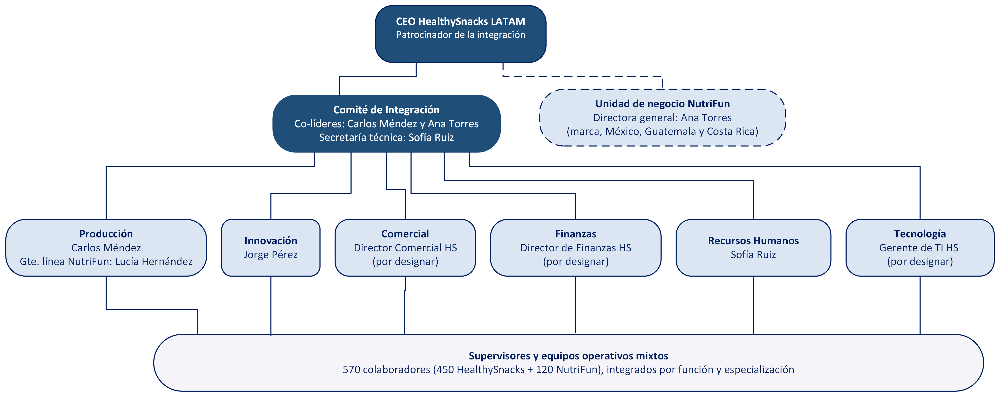

# Organigrama de integración HealthySnacks – NutriFun

Organigrama de la estructura propuesta para la integración posterior a la adquisición de **NutriFun** por **HealthySnacks LATAM**, elaborado como parte de la *Evidencia Final* de la materia **Fundamentos de Fusiones y Adquisiciones** (Universidad Tecmilenio).

## Descripción

- **CEO HealthySnacks LATAM:** patrocinador de la integración.
- **Comité de Integración:** co-liderado por Carlos Méndez y Ana Torres, con Sofía Ruiz como secretaria técnica. Coordina seis áreas funcionales: Producción, Innovación, Comercial, Finanzas, Recursos Humanos y Tecnología.
- **Unidad de negocio NutriFun:** dirigida por Ana Torres; conserva la marca y la operación en México, Guatemala y Costa Rica. La línea punteada indica una relación de reporte directa con el CEO, paralela al Comité.
- **Supervisores y equipos operativos mixtos:** 570 colaboradores (450 de HealthySnacks y 120 de NutriFun), integrados por función y especialización.

## Archivos

| Archivo | Descripción |
|---|---|
| `Organigrama_Integracion_HealthySnacks_NutriFun.png` | Imagen del organigrama |
| `Organigrama_Integracion_HealthySnacks_NutriFun.pdf` | Versión en PDF |
| `Organigrama_Integracion_HealthySnacks_NutriFun.vsdx` | Archivo editable de Microsoft Visio |

## Autor

Luis Ricardo Rivera Goitia — Universidad Tecmilenio, 2026.

## Cómo citar (APA 7)

Rivera Goitia, L. R. (2026). *Organigrama de integración HealthySnacks – NutriFun* [Repositorio de GitHub]. GitHub. https://github.com/ricgoitia/organigrama-integracion-healthysnacks-nutrifun
